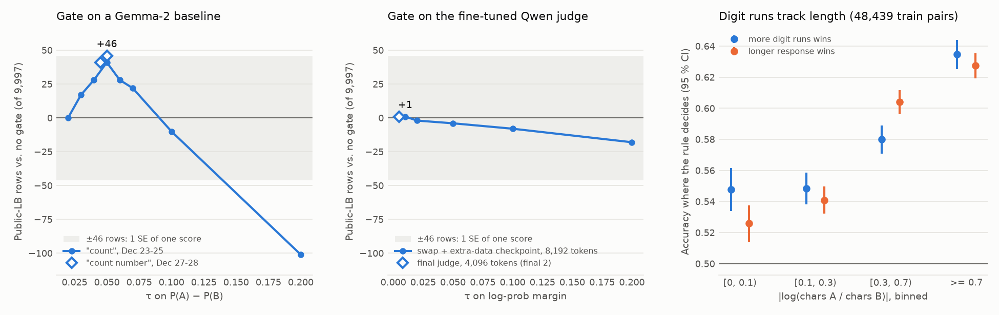
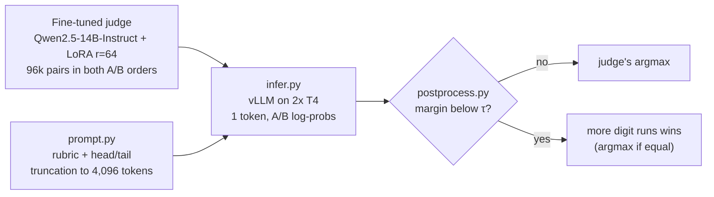

# WSDM Cup 2025, Multilingual Chatbot Arena: 5th of 950 (gold)

[](https://github.com/datahubber/wsdm-cup-5th-place-llm-judge/actions/workflows/ci.yml)

Predict which of two chatbot responses a human voter preferred, across many languages. Our
five-person team finished 5th of 950 (gold, top 0.5%). My part: the judge's input and label
functions (head+tail truncation, A/B response swap, soft labels), the post-processing strategies that
combine the judge's probabilities with content features, and the vLLM inference that serves the
fine-tuned Qwen2.5-14B judge. This repo rebuilds the inference and post-processing side as a tested
package, with an analysis of what the human preference labels actually reward.



*Left and middle: public-LB rows gained by the gate at each threshold τ, against the same model
without it; the grey band is ±1 standard error of a single score. Right: on 48,439 labelled train
pairs, "more digit runs wins" and "longer response wins" track each other in every length-ratio bin.
Numbers: [`docs/leaderboard_log.md`](docs/leaderboard_log.md),
[`results/heuristic_baselines.md`](results/heuristic_baselines.md).*

## TL;DR

- **Judge inputs and labels.** I added head+tail truncation (the start and end of the query and of
  each response stay inside the token budget), A/B response swap (every pair in both orders, so the
  judge cannot learn position bias) and soft labels (smoothed targets plus soft pseudo-labels from
  the stage-1 judge). The training steps that added them gained +0.0031, +0.0029 and +0.0030 public
  LB, on the way from 0.691 to 0.707 ([`docs/training_notes.md`](docs/training_notes.md)).
- **Judge and serving.** Qwen2.5-14B-Instruct with a 16-bit LoRA adapter answers each pair with one
  token, "A" or "B". I serve it with vLLM on Kaggle's 2× T4 (fp16, tensor parallel 2, CPU offload,
  prefix caching) and turn the A/B log-probs into a calibrated preference margin. It beat the best 4-bit
  QLoRA Gemma-2-9B baseline I ran first (0.661 public) by 3.0 to 4.6 points while still fitting the
  2× T4 budget (about 4.5 h for the test set). Final 2 ran through my inference notebook:
  0.712582 private, gold.
- **Post-processing.** I tried over 30 post-processing strategies that combine the judge's probability
  with content features (digit runs, characters, words, a 5-feature decision tree, votes). The best
  is an uncertainty gate: when the judge is within a hair of a coin flip (|margin| < τ), the response
  with more digit runs wins. On the Gemma-2 baseline this added +46 public rows (+0.46 pp); on the
  final judge it is neutral, because a well-trained judge is rarely that uncertain.
- **Finding.** The human labels carry a strong verbosity bias: "the longer answer wins" is right
  58.4 % of the time on its own, and the digit-count heuristic mostly tracks length. That helps
  predict votes, and it is exactly the bias a reward model should not learn.

## Results

| Submission | Public LB | Private LB |
|---|---|---|
| Final 1: fine-tuned judge (16-bit LoRA), argmax | 0.706812 | **0.712627** (5th / 950) |
| Final 2: fine-tuned judge through my inference notebook, with the gate (τ = 0.005) | 0.706011 | **0.712582** |
| Reference: Qwen2.5-14B-Instruct zero-shot (best of 3) | 0.625387 | |
| Reference: Gemma-2-9B 4-bit QLoRA baseline, without / with my gate | 0.661298 / 0.665899 | |

Both finals land in the gold zone and differ by one or two private rows. The public split has 9,997
rows, so one row is 0.0001 accuracy. The judge's training progression (0.691 → 0.707 public) is in
[`docs/training_notes.md`](docs/training_notes.md).

## Inference pipeline



- **Prompt.** [`prompt.py`](src/wsdm_judge/prompt.py) reproduces the judge's training format exactly:
  rubric, section tags and head+tail token budgets (15 % + 5 % of the free budget for the query,
  30 % + 10 % for each response). On 3,000 random inputs it returns exactly what the competition
  notebook returned.
- **Serving.** The 14.7B-parameter model needs about 29 GB in fp16, so it runs with tensor
  parallelism 2 over two 16 GB T4s plus 4 GB of CPU offload. Prefix caching reuses the shared
  rubric. Each pair gets a single generated token with the top-20 log-probs; the full test set runs
  in about 4.5 h.
- **Package.** [`infer.py`](src/wsdm_judge/infer.py) and [`scripts/predict.py`](scripts/predict.py)
  rewrite the competition notebook as a tested package; the tests run them against a stub vLLM.

## The uncertainty-gated tie-break

The judge's preference is the margin m = log p("A") − log p("B"). Restricted to the two labels,
P(A) = sigmoid(m), so |m| < τ selects the pairs where the judge is within sigmoid(τ) − 0.5 of a coin
flip: ±0.25 percentage points at τ = 0.01. Inside that band the response with more digit runs wins
("3.5" counts as two); outside it, or when the counts are equal, the judge's argmax stands. I wrote
the gate ([`postprocess.py`](src/wsdm_judge/postprocess.py)) and tested it in 24 scored variants on
a Gemma-2 baseline and 9 on fine-tuned Qwen checkpoints.

| Model | Gate acts on | τ | Rows vs. no gate (public LB) |
|---|---|---|---|
| Gemma-2 baseline | P(A) − P(B), 3-class softmax | 0.05 | +41 to +46 (+0.41 to +0.46 pp) |
| Fine-tuned Qwen judge | log-prob margin | 0.01 | +1 |
| Final judge, 4,096-token prompts | log-prob margin | 0.005 | +1 |

- **Gating is what makes it work.** Letting the count override the judge whenever one response had
  k times more digit runs cost 260, 199 and 56 rows for k = 2, 3 and 10.
- **The stronger the judge, the fewer near-ties.** The best τ on the fine-tuned judge was the
  smallest one tried; wider gates (τ ≥ 0.02) cost 2 to 18 rows.
- **Feature choice.** At τ = 0.05, digit runs (+46) beat character count (+31) and word count
  (+17); average word length lost 9 rows.

Every post-processing submission, with dates and references, is in
[`docs/leaderboard_log.md`](docs/leaderboard_log.md).

## What the human labels reward: a length-bias check

[`scripts/heuristic_baselines.py`](scripts/heuristic_baselines.py) scores each fallback feature on
its own over the 48,439 labelled train pairs, with 95 % Wilson intervals
([`results/heuristic_baselines.md`](results/heuristic_baselines.md)).

- "More digit runs wins" is right 58.3 % [57.8, 58.8] of the time on the 73 % of pairs where the
  counts differ, matching the 0.58 I reported during the competition.
- "Longer response wins" does as well: 58.4 %, on 99.9 % of pairs. On the 11,298 pairs where the two
  rules disagree, length is the better predictor.
- Among pairs whose lengths are within about 10 % of each other, digit runs reach 54.8 % against
  52.6 % for length: a small, not significant edge for content over length.
- The pattern holds across languages: in English, Russian, Chinese and Vietnamese the digit rule
  scores 57.8–58.4 %.

Voters tend to prefer the longer, more detailed answer. Exploiting that is a legitimate
leaderboard trick; for a reward model it is the classic verbosity bias to control for, for example
with length-matched pairs or a length penalty.

## Reproduce

The CPU part (tests and the train-set analysis) needs Python ≥ 3.10 and the competition data:
accept the rules on Kaggle, then
`kaggle competitions download -c wsdm-cup-multilingual-chatbot-arena -p data` and unzip.

```bash
pip install -e ".[dev]"
pytest                                    # 46 tests on synthetic fixtures, a few seconds
python scripts/heuristic_baselines.py --data data/train.parquet --out results/heuristic_baselines.md  # ~30 s, 1 CPU core
```

The third command reproduces the committed report exactly (for example 0.5830 for digit runs), and
`python scripts/plot_results.py` redraws the figure. The GPU path needs `pip install -e ".[infer]"`
(vllm 0.6.3.post1), two GPUs and the judge weights: `scripts/predict.py` writes `logprobs.csv` and
`submission.csv`, and `scripts/apply_gate.py` re-applies the gate on CPU for any τ; with labelled
out-of-fold log-probs, `--sweep` prints changed rows, wins, losses and a sign test per τ.

```
src/wsdm_judge/   prompt.py (rubric + head/tail truncation), infer.py (vLLM 1-token A/B log-probs),
                  postprocess.py (the gate), metrics.py (Wilson CI, sign test, tau sweep), data.py
scripts/          predict.py (GPU); apply_gate.py, heuristic_baselines.py, plot_results.py (CPU)
results/          heuristic_baselines.md, gate_sweeps.csv, my_lb_submissions.csv
docs/             leaderboard_log.md (post-processing runs), training_notes.md (the judge)
tests/            46 tests on synthetic fixtures, including predict.py against a stub vLLM
```

## Limitations

- **Leaderboard-driven selection.** As usual under a Kaggle deadline, the team trained on all
  labelled data and chose settings, τ included, on the public LB rather than out-of-fold.
  `apply_gate.py --sweep` is the tool for doing it properly on out-of-fold log-probs.
- **Unpaired comparisons.** Per-row flips were not logged, so gate gains are compared against
  single-score noise (one public-LB standard error is about 46 rows) rather than with a paired test.
- **Static truncation budgets.** When one response is short, its unused budget does not move to the
  other; cuts fall on token boundaries.

## Team and credits

Team "Just doing", five members, 5th of 950.

- **Albert Wang** (Kaggle `mianwang1024`): added the judge's input and label functions (head+tail
  truncation, A/B response swap, soft labels); owned the inference notebook behind final 2 (vLLM
  serving on 2× T4, A/B log-prob extraction); designed and tested the post-processing strategies,
  including the uncertainty gate; made 61 of the team's leaderboard submissions;
  wrote the [public solution write-up](https://www.kaggle.com/competitions/wsdm-cup-multilingual-chatbot-arena/discussion/567724)
  and presented the solution on the competition's winners' call. For this repo: the tested package
  and the length-bias analysis.
- **Chen Yulin**: ran the fine-tuning (training pipeline, training runs and the final judge;
  [code](https://github.com/lcy80366872/kaggle-project/tree/main/wsdm)).
- **Other teammates**: baselines, a separate ensemble line, and training compute.
- **c0ldzy**: the public Gemma-2 notebook "Improved Weights", the gate's first baseline.

## License

MIT, see [LICENSE](LICENSE). The rubric text in [`prompt.py`](src/wsdm_judge/prompt.py) comes from
jagatkiran's public Kaggle notebook "vLLM_Qwen14B<>Zero_shot- logits-processor-zoo" and stays under
that notebook's licence (Apache 2.0). No competition data, model weights or teammate code are
included.
